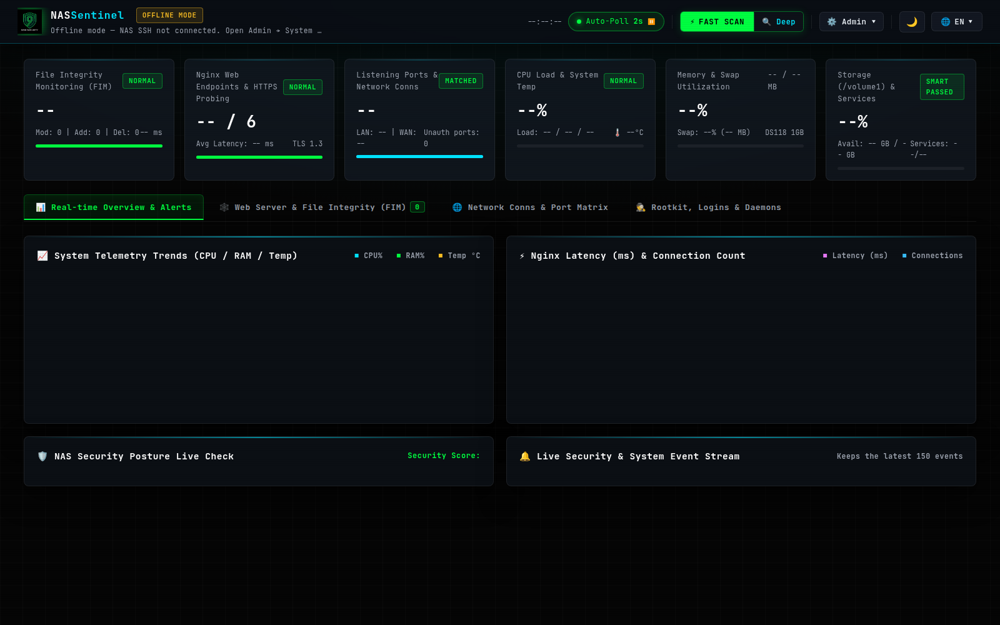

# NAS Sentinel — Synology DSM 零足跡即時安全與檔案完整性監控系統

<p align="center">
  <a href="README.md">English</a> | <b>繁體中文</b> | <a href="docs/USER_GUIDE.zh-TW.md">📖 操作手冊</a> | <a href="docs/ARCHITECTURE.zh-TW.md">🏗️ 架構規格書</a> | <a href="CHANGELOG.md">Changelog</a>
</p>

<p align="center">
  <a href="LICENSE"></a>
  <a href="https://www.synology.com"></a>
  
  
  <a href="http://127.0.0.1:8088"></a>
</p>

<p align="center">
  
</p>

NAS Sentinel 是一套專為 **Synology NAS (DSM 7.x)** 量身打造的**開源、生手友善、零足跡 (Zero Footprint)、毫秒級即時檔案完整性 (FIM) 與 Rootkit 防木馬安全監控系統**。

具備網頁版安裝引導精靈（Web Setup Wizard），以 DSM 點選步驟引導生手（開啟 SSH、授權金鑰、解鎖保護密碼）。**雙擊即可在本機開啟 SOC 儀表板**；完成第一次安全的 NAS 連線通常是一段引導式設定，而不是一鍵就變成完整監控。

---

## 📋 第一步：取得 Synology NAS 的 SSH 連線權限 (事前準備)

NAS Sentinel 透過 SSH 通道對 NAS 進行零足跡安全遙測。**安裝精靈會以三張步驟卡呈現相同流程**（含一鍵複製授權指令），您可跟精靈或跟本 README。

### 1. 開啟 DSM 的 SSH 服務
1. 以管理員帳號登入 Synology DSM 網頁桌面。
2. 前往 **「控制台」➔「終端機與 SNMP」➔「終端機」**。
3. 勾選 **「啟用 SSH 服務」**（連接埠預設維持 `22` 即可），點擊「套用」。

### 2. 確認使用者具備管理員權限
Synology DSM 原廠安全策略規定**僅允許隸屬於 `administrators` 群組的帳號透過 SSH 連線**。請至 DSM **「控制台」➔「使用者與群組」**，確認您的登入帳號已加入 `administrators` 群組。

### 3. 授權本機登入金鑰一次（二選一）
背景監控需要金鑰登入（每次掃描不能跳出密碼視窗）。建議用精靈：

- **方法 A：安裝精靈 + DSM 任務排程表（最推薦生手，免開黑視窗）**：
  1. 在精靈點 **「產生專用金鑰」**，設定至少 8 字元的保護密碼（不允許空白密碼）。
  2. 點 **「複製」**，再到 DSM **「控制台」➔「任務排程表」**。
  3. **新增 → 使用者定義的指令碼**：任務使用者選您的管理員帳號，貼上剛複製的單行指令，儲存後點 **「執行」一次**。
  4. 在這台電腦解鎖金鑰一次（`ssh-agent`），回到精靈按 **「測試連線」**。

- **方法 B：電腦終端機單行指令（備援）**（範例使用既有個人金鑰 `id_ed25519`；精靈產生的專用金鑰為 `~/.ssh/nas_sentinel_ed25519`）：
  ```bash
  # Windows PowerShell（個人金鑰範例 — 若用精靈「產生專用金鑰」請改為 nas_sentinel_ed25519.pub）：
  type $env:USERPROFILE\.ssh\id_ed25519.pub | ssh <帳號>@<NAS-IP> "mkdir -p ~/.ssh && cat >> ~/.ssh/authorized_keys && chmod 700 ~/.ssh && chmod 600 ~/.ssh/authorized_keys"

  # macOS / Linux:
  ssh-copy-id -i ~/.ssh/id_ed25519.pub <帳號>@<NAS-IP>
  ```

> *註：Synology DSM 7.x 系統韌體已原生內建 Python 3，NAS 端完全無需安裝任何套件！*

---

## ⚡ 第二步：快速上手 — 先開本機戰情室，再連 NAS

### 步驟 1：下載專案
下載本專案原始碼並解壓縮至本機任意目錄：
```bash
git clone https://github.com/9-Security/NAS-Sentinel.git
cd NAS-Sentinel
```

### 步驟 2：啟動本機 Web 伺服器
*(此步驟啟動的是您**電腦本機**的 Web 伺服器與安裝引導程序，此時**完全不需要手動修改任何設定檔**，啟動後瀏覽器會自動彈出引導介面。連上 NAS 則是後續精靈步驟。)*
- **Windows 新手路徑**：雙擊根目錄 [`start-nas-sentinel.bat`](start-nas-sentinel.bat)。  
  解壓／clone 後即可啟動本機介面。會優先使用 `runtime\python\` 可攜式 Python；若本機沒有 Python，第一次執行會從 python.org 下載官方 embed 套件（**不必**勾選「Add Python to PATH」）。背景常駐並自動開瀏覽器。說明見 [`scripts/PORTABLE-WINDOWS.md`](scripts/PORTABLE-WINDOWS.md)。
- **macOS / Linux 用戶**：在終端機執行 `./start-nas-sentinel.sh`（此階段仍需系統 `python3`）。
- **Docker 用戶**：先複製 `.env.example` → `.env` 並設定高熵 `API_TOKEN`，再執行 `docker compose up -d`。  
  Compose 預設只綁定 `127.0.0.1:8088`（不會對外開放 `0.0.0.0`）。若需 SSH 金鑰，請掛載**單一專用私鑰**，**禁止**掛載整個 `~/.ssh`。未認證的網路暴露不受支援。
- **Windows 連 NAS**：請啟用系統 **OpenSSH 用戶端**（選擇性功能）。可攜式 Python 不會取代 `ssh` / `ssh-keygen`。

### 步驟 3：本機自動解鎖儀表板，再設定 NAS 連線
啟動後瀏覽器將自動開啟 `http://127.0.0.1:8088`。
1. **本機自動解鎖（建議）**：從此電腦開啟時，瀏覽器會自動取得並儲存 API Token（僅限迴路位址 `127.0.0.1` / `::1`）。正常流程**不必**再開 `api_token.txt`。
2. **備援**：伺服器仍會在主控台印出 Token，並寫入 `nas-sentinel/data/api_token.txt`（或使用 `.env` 的 `API_TOKEN`），供手動貼上。
3. **API 仍採 Bearer**：其餘 `/api/*` 請求仍以 `Authorization: Bearer <token>` 驗證（抗 CSRF）。非本機客戶端不會取得自動解鎖 Token。
4. **安裝精靈**會以步驟卡引導（開啟 SSH → 管理員群組 → 複製授權指令），再請您填寫：
   - **NAS 區網 IP**（勿填 `127.0.0.1`，那是本機儀表板）。
   - **NAS 管理員帳號**（需在 `administrators`）。
   - **SSH 連接埠**（預設 `22`；若有改過請填實際值）。
   - **本機登入金鑰**（建議在精靈內「產生專用金鑰」，路徑須位於 `~/.ssh/`）。
5. 按 **「測試連線並探測 NAS」**：成功會顯示 DSM／架構並釘選 Host Key 指紋；失敗時介面會依錯誤類型顯示**接下來該怎麼做**（逾時／拒絕／找不到主機／金鑰未授權／指紋不符）。
6. 按 **「🛡️ 測試並上線」**：寫入 `data/config.json`（權限 `0600`），SSH 成功時建立基線並進入戰情室。也可先 **「儲存連線設定」**，稍後再上線。

> 💡 **習慣使用文字設定檔的使用者（可選／進階）**：  
> 複製 `.env.example` 為 `.env`，預先設定 `API_TOKEN`、`NAS_HOST`、`NAS_USER`、`NAS_PORT` 再啟動。翻找 `api_token.txt` 僅為**備援**——本機自動解鎖才是正常流程。

---

## 🚀 常駐服務與開機自啟動管理

NAS Sentinel 支援完全獨立於終端機/命令列的純背景常駐執行，關閉終端機或 IDE 均不會中斷：

### 1. 手動背景啟動
**雙擊 `start-nas-sentinel.bat`**（新手啟動本機伺服器）。伺服器以 `pythonw` 於系統背景運作，並自動開啟儀表板：
```bat
start-nas-sentinel.bat
```
- **儀表板網址**：`http://127.0.0.1:8088`
- 若本機沒有系統 Python，第一次會下載可攜式 CPython 到 `runtime\python\`（也可把該資料夾預先打進 zip，供離線雙擊）。

### 2. 開機自動啟動（最推薦）
將 NAS Sentinel 註冊為 Windows 開機登入自啟動排程，開機後系統在背景自動監控：
```bat
install-autostart-service.bat
```
- 若要移除開機自啟動排程，雙擊執行：`uninstall-autostart-service.bat`。

### 3. 一鍵停止背景服務
若需停止背景運作的 NAS Sentinel 伺服器，雙擊執行：
```bat
stop-nas-sentinel.bat
```

---

## 🌟 核心功能特色

1. **零足跡安全遙測 (Zero Footprint)**：
   - NAS 系統分割區通常僅約 2.3 GB，傳統資安 Agent（Wazuh, OSquery, Tripwire 等）過於厚重容易寫滿磁碟。
   - NAS Sentinel 所有採集均透過本機 Python 經由 SSH stdin 注入執行，輸出至 stdout，**完全不在 NAS 本地磁碟落檔、免安裝任何套件 (免 ipkg/opkg/gcc)**，對 NAS 的 CPU／記憶體負擔保持輕量。
2. **🕸️ 網頁伺服器與檔案完整性監控 (FIM)**：
   - 監控 Nginx 設定 (`/etc/nginx`)、DSM 網頁目錄 (`/usr/syno/synoman`)、自架網站目錄 (`/volume1/web`)、系統安全設定等數千個關鍵檔案（精確數量依基線與 DSM 而定）。
   - 嚴格比對 SHA-256 雜湊、Linux 權限模式、擁有者，並內建分塊滑動視窗 Webshell 特徵比對。
3. **⚡ Linux 核心 inotify 毫秒級事件串流**：
   - 使用 Python 內建 `ctypes` 調用 NAS Linux 核心 `libc.so.6` 的 inotify 系統呼叫，免安裝 auditd，零磁碟消耗。
   - 即時監聽數百個關鍵網頁與系統目錄（監聽範圍依 DSM／基線而定），捕捉新建、修改、寫入完成、更名、刪除與權限變更。
4. **🕵️ DSM Rootkit 與系統指令防木馬檢測**：
   - 實作對標 `chkrootkit` 與 `rkhunter` 的 6 大核心檢測：
     - 高風險系統指令 (`/bin/ps`, `ls`, `netstat`, `sshd`, `sudo`, `nginx` 等) 實體 SHA-256 驗證
     - `/etc/ld.so.preload` 與 `/proc/*/environ` 動態連結器劫持檢測
     - 隱藏幽靈程序與無檔案執行檔 (`/proc` vs `ps`) 交叉比對
     - 網卡混雜模式竊聽檢測 (`IFF_PROMISC`)
     - Linux 核心模組白名單比對（`lkm_baseline.json`；模組數量隨 DSM 而異）
     - 已知 Rootkit 特徵路徑與 `/dev/shm`、`/tmp` ELF 二進位執行檔偵測
5. **🌐 網路連線與監聽埠矩陣**：
   - 自動將活動網路連線分類為本機、區網 (LAN)、公網 (WAN)。
   - 即時比對監聽埠基線，任何非預期的新開放埠將立刻觸發高風險警報。
6. **🌐 Cloudflare 邊界網站刺探與 WAF 防禦情資 (Edge Threat Intelligence)**：
   - 針對 NAS 透過 Cloudflare Tunnel 發布至公網設計，直連 Cloudflare GraphQL Analytics API (`firewallEventsAdaptive`)。
   - 零硬碟耗損、不需開啟 DSM Nginx access log，即可自 Cloudflare 邊界節點拉取公網對網站目錄的探測與掃描紀錄（`/.env`、`wp-login`、`/.git`、Webshell 踩點與惡意爬蟲）。
   - 支援自動分類威脅等級（敏感設定檔探測、CMS 漏洞掃描、資料庫後台刺探等），提供 TOP 5 刺探目標與來源國家統計。
7. **🎨 Nine-Security 官方品牌 Cyber SOC 視覺系統**：
   - 採用 [Nine-Security](https://nine-security.com) 品牌高科技戰情室風格：深黑網格底圖 (`#050505`)、微環境掃描線 (Scanlines)、Terminal Matrix Green (`#00ff41`) 與 Cyber Cyan (`#00e5ff`)。
   - 引入 Google Fonts `Inter` 與 `JetBrains Mono`，搭配 DPR 銳利折線圖。
   - 內建 2 秒操作防刷冷卻、全域鎖定防呆與安全確認彈窗。

---

## 📁 目錄結構

```
NAS-Sentinel/
├── nas-sentinel/                # [主控核心程式碼]
│   ├── server.py                # 本機 HTTP 伺服器、狀態引擎、REST API 與排程
│   ├── collector_remote.py      # NAS 遠端唯讀遙測、FIM 與 Rootkit 採集腳本
│   ├── inotify_stream_remote.py # NAS 遠端 Linux 核心 inotify 毫秒串流引擎
│   ├── cloudflare_intel.py      # Cloudflare 邊界 GraphQL 刺探情資客戶端
│   ├── static/                  # Cyberpunk 戰情室 Web 前端
│   │   ├── index.html           # 儀表板與 Setup Wizard 前端介面
│   │   ├── app.js               # 前端控制器、狀態輪詢與安裝精靈
│   │   ├── logo_v2.png          # Nine-Security 品牌 Logo
│   │   └── favicon.png          # 官方 Favicon
│   └── data/                    # 基線與本機設定儲存區 (敏感設定已由 .gitignore 忽略)
│       ├── config.example.json  # 初始設定檔範本
│       ├── fim_baseline.json    # 系統檔案完整性基準
│       ├── port_baseline.json   # 網路監聽埠基準
│       └── lkm_baseline.json    # 核心模組基準
│
├── start-nas-sentinel.bat       # Windows 背景啟動 ← 新手按這個
├── stop-nas-sentinel.bat        # Windows 停止服務腳本
├── install-autostart-service.bat# Windows 開機登入自啟動安裝檔
├── uninstall-autostart-service.bat # Windows 開機自啟動解除檔
├── start-nas-sentinel.sh        # Linux / macOS 啟動腳本
├── scripts/                     # Windows 可攜式 Python 輔助
│   ├── ensure-portable-python.ps1
│   └── PORTABLE-WINDOWS.md
├── runtime/                     # 可選本機可攜式 CPython（gitignore；可自動下載）
├── Dockerfile                   # Docker 容器化構建檔
├── docker-compose.yml           # Docker Compose 部署配置
├── LICENSE                      # MIT 開源授權條款
├── CHANGELOG.md                 # 版本更新紀錄
├── README.md                    # 英文版文件說明
└── README.zh-TW.md              # 繁體中文說明（本檔）
```

---

## 🔒 隱私與安全優先

NAS Sentinel 以嚴格的隱私保護原則打造：
- **本機優先**：預設綁定 `127.0.0.1`。Docker Compose 僅發布 `127.0.0.1:8088`。**未認證的網路暴露不受支援。**
- **API 驗證**：除 `/api/auth/status` 與僅限迴路的 `/api/auth/local-token`（僅信任 TCP peer `127.0.0.1` / `::1`；從不信任代理標頭）外，所有 `/api/*` 路由皆需 `Authorization: Bearer <API_TOKEN>`（標頭驗證、抗 CSRF）。Cloudflare Token 不會以明文回傳於 API（僅遮罩／是否已設定）。
- **SSH 強化**：金鑰路徑必須位於 `~/.ssh`；自動產生的金鑰需設定保護密碼；首次成功設定後會釘選 Host Key 指紋。
- **零雲端遙測**：您的遙測與掃描結果不會離開本機。
- **Git 安全憑證**：實際設定、API Token 檔、known_hosts 與機器基線皆已加入 gitignore；倉庫僅追蹤 `*.example.json` 範本。
- **唯讀遙測**：對 NAS 的遠端執行 100% 唯讀，不會對 DSM 系統做未授權變更。

---

## 📜 開源授權

本專案採用 **[MIT License](LICENSE)** 授權開源。由 **[Nine-Security.INC](https://nine-security.com)** 品牌維護與技術支援。
